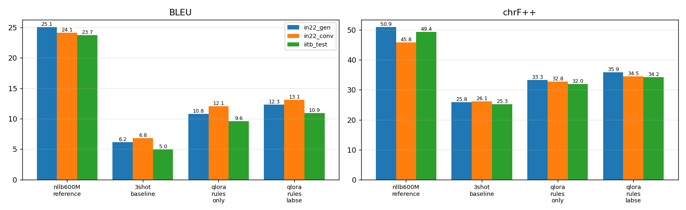
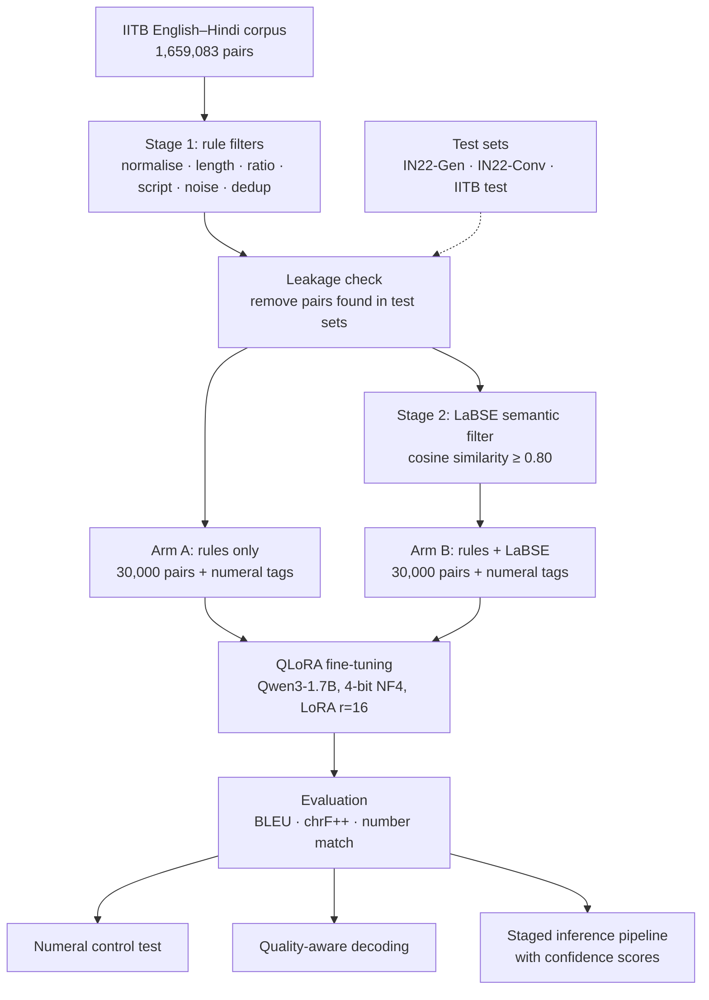
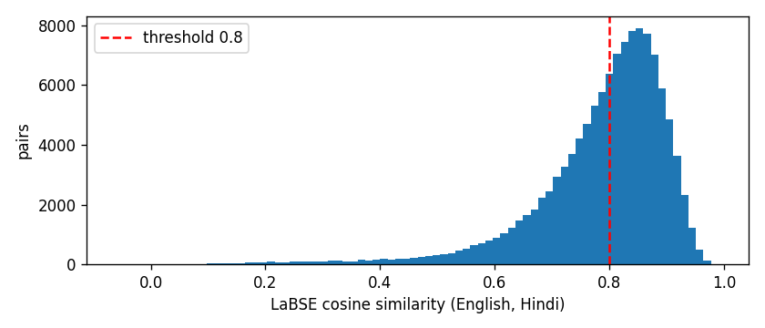
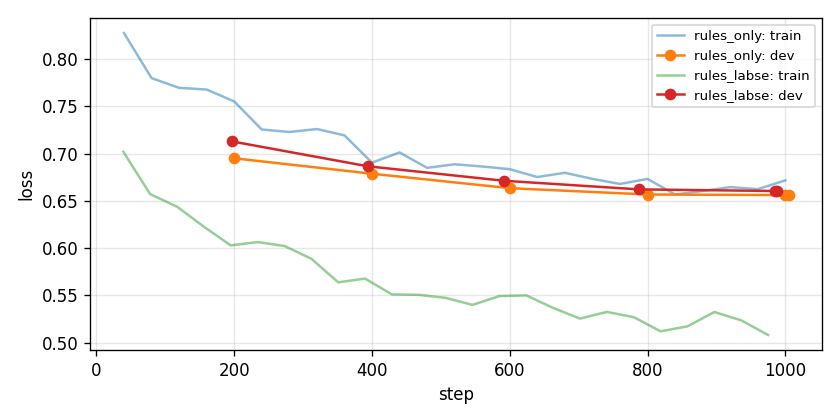

# English → Hindi Neural Machine Translation with QLoRA and Semantic Data Filtering

Fine-tuning **Qwen3-1.7B** for English→Hindi translation with **QLoRA** on a single free Kaggle T4 GPU, with a two-stage data-cleaning pipeline, a controlled ablation study, and prompt-based numeral control.

| | |
|---|---|
| **Base model** | [`Qwen/Qwen3-1.7B-Base`](https://huggingface.co/Qwen/Qwen3-1.7B-Base) |
| **Method** | QLoRA: 4-bit NF4 base + LoRA (r=16), 1.0% of parameters trained |
| **Training data** | IIT Bombay English–Hindi corpus, cleaned from 1.66M to 30,000 pairs per run |
| **Hardware** | 1× NVIDIA T4 (16 GB), about 85 minutes of training |
| **Adapter** | `huggingface.co/<your-username>/qwen3-1.7B-en-hi-qlora` |

## Highlights

- **Doubled BLEU** over the untuned model: 6.16 → **12.32** on IN22-Gen (+10.1 chrF++), with similar gains on every test set.
- **Ablation:** filtering the training data by meaning with LaBSE improved BLEU by **+1.1 to +1.5** and chrF++ by **+1.7 to +2.6** on all three test sets, with model, settings and data size held equal.
- **Numeral control:** a `Numerals:` tag in the prompt switches output digits between 2024 and २०२४ with **98.9% / 98.6%** accuracy.
- **Number accuracy** rose from 71.6% to **92.5%**.
- **84.4%** of test sentences improved after fine-tuning, at every sentence length.

## Results

1,000 sentences per test set. Higher is better for all metrics.

| System | BLEU IN22-Gen | BLEU IN22-Conv | BLEU IITB | chrF++ IN22-Gen | chrF++ IN22-Conv | chrF++ IITB | Number match IN22-Gen |
|---|---|---|---|---|---|---|---|
| NLLB-200-600M (reference, not trained) | 25.05 | 24.13 | 23.74 | 50.94 | 45.81 | 49.35 | 98.1% |
| Qwen3-1.7B, 3-shot prompting (baseline) | 6.16 | 6.80 | 4.98 | 25.82 | 26.14 | 25.27 | 71.6% |
| Qwen3-1.7B + QLoRA, rules-only data | 10.78 | 12.06 | 9.61 | 33.33 | 32.77 | 32.01 | 89.7% |
| **Qwen3-1.7B + QLoRA, rules + LaBSE data (final)** | **12.32** | **13.14** | **10.95** | **35.89** | **34.48** | **34.25** | **92.5%** |



**About the NLLB gap:** NLLB-200 is a dedicated translation model trained on far more parallel text. This project fine-tunes a general-purpose 1.7B LLM for 85 minutes on 30,000 pairs. The aim is to measure what careful data work and parameter-efficient fine-tuning add, not to beat a purpose-built MT system.

### Ablation: does semantic filtering help?

Two models were trained with identical settings and the same number of examples (34,289). The only difference is the training data.

| Test set | ΔBLEU (LaBSE − rules only) | ΔchrF++ |
|---|---|---|
| IN22-Gen | +1.54 | +2.56 |
| IN22-Conv | +1.08 | +1.71 |
| IITB test | +1.34 | +2.24 |

Semantic filtering helped on every test set and both metrics.

### Numeral control

| Requested digits | Control accuracy |
|---|---|
| International (2024) | 98.9% |
| Devanagari (२०२४) | 98.6% |

A first trial that gave each digit-containing pair one random tag reached only 74.0% / 22.4%. Adding the same sentence once with **each** tag, so that the tag is the only difference the model sees, fixed it.

### Quality-aware decoding

300 IN22-Gen sentences, 6 candidates per sentence (1 greedy + 5 sampled), chosen without a reference:

| Decoding | BLEU | chrF++ | Number match | Relative cost |
|---|---|---|---|---|
| Greedy | 12.09 | 35.65 | 91.8% | 1× |
| MBR (chrF) | 12.20 | 36.21 | 93.4% | 6.5× |
| LaBSE quality estimation | 11.82 | 35.60 | 92.9% | 6.5× |

Reranking adds little to the fine-tuned model, although it added +2.9 chrF++ to a weaker model trained on 2,000 pairs. Reranking pays off for weak models, not well-tuned ones, so greedy decoding is used for inference.

## Pipeline



## Data cleaning

The IITB corpus mixes good parallel text with software UI strings, dictionary entries, misaligned lines and even other languages. Cleaning ran in two stages.

**Stage 1: rule-based filters**

| Step | Rule | Pairs left | Removed |
|---|---|---|---|
| Raw corpus | — | 1,659,083 | — |
| Length | 4–60 English words, 4–80 Hindi words | 1,070,440 | 588,643 |
| Length ratio | Hindi ÷ English words between 0.6 and 2.2 | 1,039,243 | 31,197 |
| Script | Hindi >90% Devanagari; no Devanagari in English | 1,011,935 | 27,308 |
| Noise | No URLs, `%s`, `_` menu shortcuts, HTML; not an untranslated copy | 1,001,508 | 10,427 |
| Duplicates | Each English and each Hindi sentence kept once | 699,356 | 302,152 |
| Leakage | Remove pairs whose English appears in a test or dev set | 699,350 | 6 |

All text is Unicode NFC-normalised first.

**Stage 2: semantic filtering with [LaBSE](https://huggingface.co/setu4993/LaBSE)**

Rules can't tell whether the Hindi actually means the same as the English. LaBSE embeds sentences from 109 languages in one vector space; pairs with cosine similarity below **0.80** (the threshold used for IndicTrans2's corpus) are removed. Of 120,000 rule-clean pairs, **55.7%** passed.

Examples that passed every rule but were rejected by LaBSE:

| Score | English | Hindi in the corpus | Problem |
|---|---|---|---|
| 0.03 | Joze swam and swam. | कौन जा रहा है उधर? ("Who is going there?") | Misaligned |
| 0.08 | On the importance of co-operative movement, he has written that - | सहकारी चलवल ही खरी निधर्मी चलवल आहे… | Marathi, not Hindi (same script) |
| 0.13 | Consolidation of 'plans' within a 'scheme' of mutual fund | A line about rent deductions under section 80GGG | Neighbouring lines swapped |



## Training details

| Setting | Value |
|---|---|
| Base model | Qwen3-1.7B-Base (loaded in 4-bit NF4, double quantisation, fp16 compute) |
| LoRA | r=16, alpha=32, dropout=0.05 on `q,k,v,o,gate,up,down` projections |
| Trainable parameters | 17.4M of 1.74B (1.0%) |
| Training examples | 30,000 pairs + 4,289 paired numeral examples; 31,591 kept after a 256-token length limit |
| Optimiser | Paged AdamW 8-bit, learning rate 2e-4, cosine schedule, 3% warm-up |
| Batch | 8 × 4 gradient accumulation = 32 effective |
| Epochs | 1 (best checkpoint by dev loss) |
| Loss | Computed on the Hindi output only (prompt tokens masked) |
| Training time | ~85 min per run on one T4; peak GPU memory 13.7 GB |

**Prompt format** (used in training and inference):

```
Translate English to Hindi.
Numerals: international
English: The company sold 4,500 units in 2023.
Hindi:
```

**Tokenizer fertility:** Qwen3's tokenizer uses **4.94 tokens per Hindi word** against 1.32 per English word, so Hindi output costs about 3.7× more tokens. This drove the 256-token sequence limit and most of the generation time.



## Usage

```bash
pip install "transformers>=5.0" peft accelerate bitsandbytes
```

```python
import torch
from transformers import AutoTokenizer, AutoModelForCausalLM
from peft import PeftModel

ADAPTER = "<your-username>/qwen3-1.7B-en-hi-qlora"   # or a local folder

tok = AutoTokenizer.from_pretrained(ADAPTER)
base = AutoModelForCausalLM.from_pretrained("Qwen/Qwen3-1.7B-Base",
                                            dtype=torch.float16, device_map="auto")
model = PeftModel.from_pretrained(base, ADAPTER).eval()

def translate(text, numerals="international"):   # or "native" for Devanagari digits
    prompt = f"Translate English to Hindi.\nNumerals: {numerals}\nEnglish: {text}\nHindi:"
    enc = tok(prompt, return_tensors="pt", add_special_tokens=False).to(model.device)
    out = model.generate(**enc, max_new_tokens=300, do_sample=False,
                         no_repeat_ngram_size=12, stop_strings=["\n"], tokenizer=tok,
                         pad_token_id=tok.eos_token_id)
    return tok.decode(out[0, enc["input_ids"].shape[1]:], skip_special_tokens=True).strip()

print(translate("The company sold 4,500 units in 2023 and expects to cross 12,000 by 2026."))
# कंपनी ने 2023 में 4,500 यूनिट्स की बिक्री की और 2026 तक 12,000 यूनिट्स तक पहुंचने का आश्वासन दिया है।
print(translate("India launched 3 new satellites in 2025.", numerals="native"))   # digits come out as ३, २०२५
```

The prompt must match the training format exactly; with a different prompt the model behaves like the untuned base model.

## Reproduce

1. Open `en_hi_qlora_final.ipynb` on Kaggle.
2. Settings: Accelerator **GPU T4 x2** (one GPU is used), Internet **On**.
3. Optional: accept the [FLORES+](https://huggingface.co/datasets/openlanguagedata/flores_plus) terms and add a Hugging Face token as a Kaggle secret named `HF_TOKEN` to add FLORES+ to the evaluation.
4. For a 30-minute dry run, set `POOL_SIZE = 8_000`, `N_TRAIN = 2_000`, `EVAL_LIMIT = 100`, `RERANK_LIMIT = 40`.
5. For the full run, use `POOL_SIZE = 120_000`, `N_TRAIN = 30_000`, `EVAL_LIMIT = 1000`, `RERANK_LIMIT = 300`, then **Save Version → Save & Run All**. It takes about 5 hours.

Seed 42 throughout.

## Repository structure

```
├── en_hi_qlora_final.ipynb        # full pipeline: data → training → evaluation
├── README.md
├── results/
│   ├── summary.json               # every headline number
│   ├── results.csv                # all systems × test sets
│   ├── decoding_experiment.csv
│   ├── error_analysis.md          # biggest improvements and regressions
│   └── preds__qwen_qlora_rules_labse__*.csv
└── assets/
    ├── results_chart.png
    ├── loss_curves.png
    ├── labse_hist.png
    └── length_hist.png
```

## Limitations

- The model still trails NLLB-200-600M by about 12 BLEU.
- On rare words or unusual notation it sometimes outputs nonsense, e.g. "1st millennium BCE" → "एक्सएनएक्सएन ईसीएम…". The pipeline's confidence score can flag these.
- COMET scores are not included; the COMET package conflicted with the Kaggle environment.
- Test sets were sampled to 1,000 sentences each. FLORES+ was not evaluated (gated dataset).
- Trained on 30,000 pairs for one epoch; more data, more epochs or a larger model (Qwen3-4B) would likely close part of the gap.

## Tech stack

Python · PyTorch · Hugging Face Transformers · PEFT (LoRA/QLoRA) · bitsandbytes · Hugging Face Datasets · LaBSE · sacreBLEU · pandas · NumPy · Matplotlib · Kaggle (NVIDIA T4)

## Acknowledgements and licences

- **Data:** [IIT Bombay English–Hindi Parallel Corpus](https://huggingface.co/datasets/cfilt/iitb-english-hindi) (CC BY-NC 4.0). Because of this licence, the trained adapter is for research and non-commercial use.
- **Evaluation:** IN22-Gen and IN22-Conv benchmarks from [AI4Bharat](https://github.com/AI4Bharat/IndicTrans2).
- **Models:** [Qwen3](https://huggingface.co/Qwen/Qwen3-1.7B-Base), [LaBSE](https://huggingface.co/setu4993/LaBSE), [NLLB-200](https://huggingface.co/facebook/nllb-200-distilled-600M).
